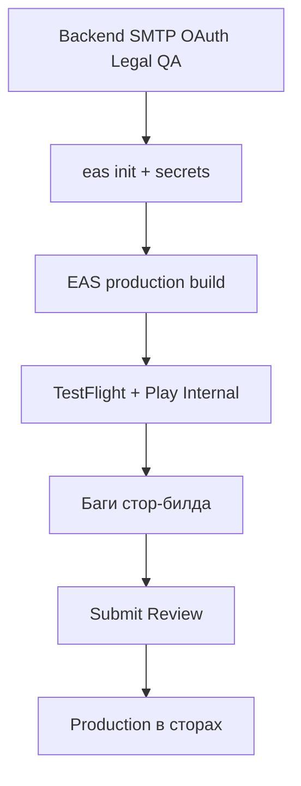

# Публикация Feel Good Challenge (iOS + Android)

**Сначала прочитайте простой гайд:** [`PUBLISH_SIMPLE_RU.md`](PUBLISH_SIMPLE_RU.md)

- Android по шагам: [`PLAY_SIMPLE_RU.md`](PLAY_SIMPLE_RU.md)
- iOS по шагам: [`IOS_SIMPLE_RU.md`](IOS_SIMPLE_RU.md)

Главная инструкция на русском: путь от разработки в Expo Go до скачивания из App Store и Google Play.


Подробный статус готовности: [`PREPUBLISH_STATUS.md`](PREPUBLISH_STATUS.md)  
Чеклист шагов: [`SUBMIT_CHECKLIST.md`](SUBMIT_CHECKLIST.md)  
Сборка: [`EAS_BUILD.md`](EAS_BUILD.md)

---

## 1. Expo Go ≠ приложение из магазина

| | Сейчас (Expo Go) | В сторах |
|--|------------------|----------|
| Как ставится | QR / Metro на ПК | Скачать из Store |
| Ссылки (OAuth, reset) | `exp://IP:порт/...` | `feelgood://...` |
| Уведомления | Ограничены | Полноценные (APNs / FCM) |
| Кто держит код | Ваш компьютер + Metro | Бинарь на телефоне + ваш backend |

Пользователи магазина **не** видят Metro. Нужна production-сборка через **EAS**.

---

## 2. Что обязательно до публикации (иначе «будет отваливаться»)

### Backend и Auth
- [ ] Миграции + Edge Functions задеплоены (`.\scripts\deploy-backend.ps1`)
- [ ] В `.env` и в **EAS secrets** — актуальный URL и publishable key проекта `bruvmdcstlkszvjruska`
- [ ] **Custom SMTP** + Sender `Feel Good Challenge` — без этого free-tier **не даёт** сменить шаблоны ([`SMTP_AND_EMAIL_RU.md`](SMTP_AND_EMAIL_RU.md))
- [ ] После SMTP: `.\scripts\apply-auth-email-templates.ps1` (Reset OTP `{{ .Token }}`)
- [ ] Google OAuth: redirect на `…/auth/v1/callback`, **App name** в Google Consent = Feel Good Challenge
- [ ] Apple Sign In для iOS (если есть Google)
- [ ] Страницы Privacy / Terms открываются (не 404)

### Продукт
- [ ] Полный QA по [`PREPUBLISH_STATUS.md`](PREPUBLISH_STATUS.md) и [`QA_RUNBOOK.md`](QA_RUNBOOK.md)
- [ ] Mindset-аудио CDN (`EXPO_PUBLIC_MINDSET_AUDIO_BASE_URL`), если нужно в релизе
- [ ] Уведомления проверены на **dev/production build**, не только в Expo Go

### Аккаунты
- [ ] [Expo](https://expo.dev/signup)
- [ ] [Apple Developer](https://developer.apple.com) (~$99/год)
- [ ] [Google Play Console](https://play.google.com/console) (~$25 разово)

Без Custom SMTP и живых legal URL публиковать в сторы **нельзя** как «профессиональный» продукт.

---

## 3. Как публикуется именно это приложение

Идентификаторы уже в `app.json`:
- iOS / Android: `com.feelgoodsociety.challenge`
- Название: Feel Good Challenge
- Схема deep link: `feelgood`

Сейчас в `app.json` стоит заглушка `REPLACE_WITH_EAS_PROJECT_ID` — её нужно заменить после `eas init`.

### Шаг A — один раз настроить EAS

```powershell
cd "d:\feel good\apps\mobile"
npm install -g eas-cli
eas login
eas init
```

Скопируйте Project ID в `app.json` → `expo.extra.eas.projectId`.

Секреты (обязательно для store-сборки):

```bash
eas secret:create --name EXPO_PUBLIC_SUPABASE_URL --value "https://bruvmdcstlkszvjruska.supabase.co"
eas secret:create --name EXPO_PUBLIC_SUPABASE_PUBLISHABLE_KEY --value "<ваш publishable key>"
# по необходимости:
eas secret:create --name EXPO_PUBLIC_MINDSET_AUDIO_BASE_URL --value "https://cdn.example.com/mindset"
```

### Шаг B — Apple

1. App ID `com.feelgoodsociety.challenge` + Sign In with Apple  
2. Приложение в App Store Connect  
3. В `eas.json` → `submit.production.ios`: `appleId`, `ascAppId`, `appleTeamId`

### Шаг C — Google Play

1. Приложение с package `com.feelgoodsociety.challenge`  
2. Service account JSON → `apps/mobile/google-play-service-account.json` (в git не коммитить)  
3. Путь в `eas.json` уже указан

### Шаг D — сборка

```powershell
# Внутреннее тестирование
eas build --platform ios --profile preview
eas build --platform android --profile preview

# Релиз для сторов
eas build --platform all --profile production
```

Или: `.\scripts\eas-build.ps1 -Profile production -Platform all`

Результат: **.ipa** (iOS) и **.aab** (Android).

### Шаг E — тест «как у пользователя»

1. **iOS:** App Store Connect → TestFlight (internal → external)  
2. **Android:** Play Console → Internal testing → после QA в Production  

Здесь проверяют `feelgood://`, Google/Apple, пуши — это важнее Expo Go.

### Шаг F — листинг и модерация

- Тексты и скрины: [`STORE_LISTING.md`](STORE_LISTING.md) (EN)  
- Privacy Apple: [`APPLE_PRIVACY.md`](APPLE_PRIVACY.md)  
- Play Data safety: [`GOOGLE_DATA_SAFETY.md`](GOOGLE_DATA_SAFETY.md)  

Отправка:

```powershell
eas submit --platform ios --profile production --latest
eas submit --platform android --profile production --latest
```

После одобрения — публикация в Production.

---

## 4. Рекомендуемый порядок «как профи»



1. Добить backend и QA  
2. `eas init` + secrets  
3. Production build  
4. TestFlight + Internal testing  
5. Исправить баги  
6. Submit → Review → Production  
7. Дальше: новые версии через новый `version` / autoIncrement + новый EAS build  

---

## 5. Частые ошибки

- Публиковать, пока стоит встроенная почта Supabase (~2 письма/час) — signup/reset будут блокироваться.  
- Оставить `REPLACE_WITH_EAS_PROJECT_ID` — сборка EAS не поедет.  
- Проверять только в Expo Go — deep links и пуши в сторе другие.  
- Google Consent «Supabase wants…» — правится в Google Cloud, не в коде RN.  
- Privacy/Terms 404 — сторы и Settings требуют живые URL.  

---

## 6. Связанные документы

| Файл | О чём |
|------|--------|
| [`PREPUBLISH_STATUS.md`](PREPUBLISH_STATUS.md) | Готовность и чеклист QA |
| [`HUMAN_STEPS.md`](HUMAN_STEPS.md) | Что делаете вручную вы |
| [`SUBMIT_CHECKLIST.md`](SUBMIT_CHECKLIST.md) | Конец-в-конец до сторов |
| [`EAS_BUILD.md`](EAS_BUILD.md) | Команды EAS |
| [`AUTH_SETUP.md`](AUTH_SETUP.md) | Auth, SMTP, Google branding |
| [`NEW_SUPABASE_SETUP.md`](NEW_SUPABASE_SETUP.md) | Новый проект Supabase |

Код приложения: `apps/mobile/`. Скрипты: `scripts/deploy-backend.ps1`, `scripts/eas-build.ps1`.
